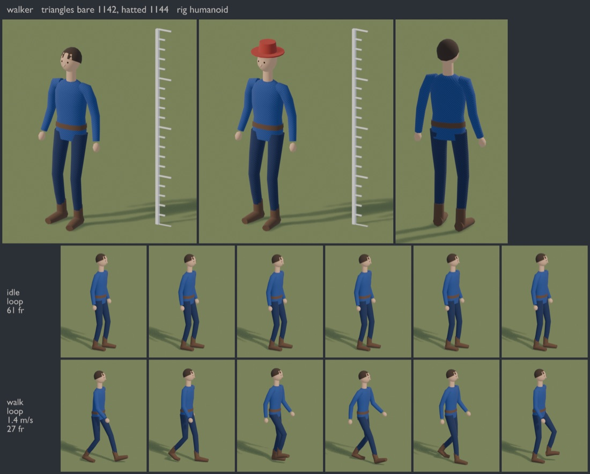
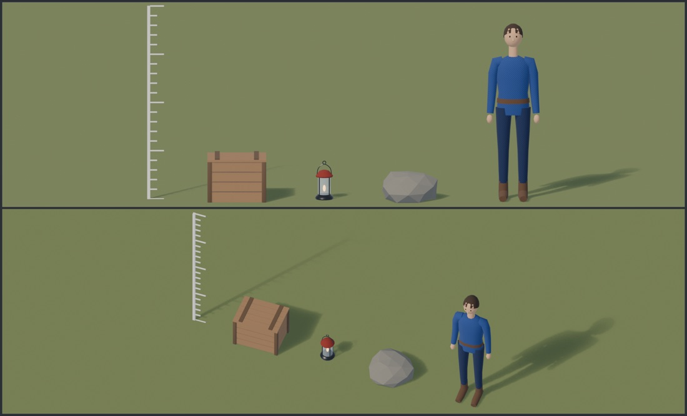

# blendpipe

Procedural low-poly game assets, written as small Python modules and built headless in Blender. One command builds
every model, checks it against budgets and rules, exports it as a compressed glb (meshopt via gltfpack, ready for
three.js or any glTF engine) and renders review sheets you can look at.

- **Deterministic.** Every mesh is built from vertex lists in a fixed order (no `bpy.ops` primitives) and randomness
  is seeded, so the same code writes the same bytes, every time. Commit the glbs and diffs mean something.
- **Checked.** A model that breaks a rule fails the build and the message says which rule and by how much. The rules
  cover triangle budgets, file size, faces built inside out, standing on the ground, sockets, skin weights, loops
  that don't close, feet that sink or float, and clips leaking into the wrong file.
- **Small and valid.** gltfpack quantises and meshopt-compresses each file. A two-variant skinned character with
  two clips and a normal-mapped texture is about 36 KB. The output passes the Khronos glTF validator with no errors.
- **Reviewable.** `--sheet` renders each model by a 2 m ruler, from the back, per group and as a filmstrip of every
  clip, plus a lineup of everything at one scale.
- **Characters included.** Skinned meshes with smooth weights, a ready 21-bone humanoid rig, IK posing, and
  walk/run cycles whose planted feet don't slide.



## Prerequisites

| What | Version | Why |
|---|---|---|
| [Blender](https://www.blender.org/download/) | 5.2 (5.0 or newer works; tested on 5.2.2) | builds, exports and renders, headless |
| Python | 3.9 or newer | runs the `blendpipe` command (models run in Blender's own Python) |
| [Node.js](https://nodejs.org/) with npm | 18 or newer | runs gltfpack, which compresses the glbs |
| [gltfpack](https://www.npmjs.com/package/gltfpack) | 1.2.0 (pinned) | installed per project by `npm install` (or use a native binary, see below) |
| git | any | to install blendpipe from this repository |

On macOS with Homebrew: `brew install --cask blender && brew install node pipx`.
On Windows, use the installers from blender.org, nodejs.org and python.org.
On Linux, see [Linux](#linux).

Tested on macOS (Apple silicon) with Blender 5.2.2, Node 24 and Python 3.14, and on Linux (see below). Windows should
work, since nothing is macOS-specific, but hasn't been tried yet.

## Install

1. **Install Blender 5.2.** blendpipe finds it on your `PATH` as `blender`, in `/Applications/Blender.app` (macOS),
   in `C:\Program Files\Blender Foundation\` (Windows) or in the usual Linux places (see [Linux](#linux)). If yours
   is elsewhere, point `BLENDER` at the executable:

   ```sh
   export BLENDER=/path/to/blender
   ```

2. **Install Node.js** (18 or newer), for gltfpack.

3. **Install blendpipe.** [pipx](https://pipx.pypa.io/) keeps it in its own environment:

   ```sh
   pipx install git+https://github.com/sanvisser/blendpipe.git
   # or: python3 -m pip install --user git+https://github.com/sanvisser/blendpipe.git
   ```

4. **Start a project from the starter.** You get four example models and the gltfpack pin:

   ```sh
   blendpipe new my-art
   cd my-art
   npm install
   ```

5. **Check that everything is found.** `doctor` reports Blender, Node.js and gltfpack:

   ```sh
   blendpipe doctor
   ```

6. **Build, then look at the sheets:**

   ```sh
   blendpipe build . out/assets --sheet out/sheets
   open out/sheets/walker.png        # Linux: xdg-open out/sheets/walker.png, Windows: start out\sheets\walker.png
   ```

   You get `out/assets/props/{crate,lantern,rock}.glb`, `out/assets/units/walker.glb` (and `walker-far.glb`), and a
   sheet per model plus `lineup.png` in `out/sheets`.

To update later, run `pipx upgrade blendpipe` (or `pip install --upgrade --force-reinstall git+https://...`).

## Linux

blendpipe builds, checks and exports on Linux without a display or a GPU: Blender runs with `--background`.

**Install Blender.** Take the Linux tarball from [blender.org](https://www.blender.org/download/) and unpack it where
you like. blendpipe needs Blender 5.0 or newer, and some distributions package an older one (Ubuntu 24.04's is 4.0), so
`blendpipe doctor` will say so if that is the one it finds. The tarball's `blender` binary links against a few system
libraries even without a window (`libGL`, `libX11`, `libXi`, `libXrender`, `libXfixes`, `libxkbcommon`, `libSM`);
on a minimal install, add them (on Debian and Ubuntu, for example: `sudo apt install libgl1 libxi6 libxrender1
libxkbcommon0 libsm6 libxfixes3`).

```sh
mkdir -p ~/.local/opt && tar -xJf blender-5.2.2-linux-x64.tar.xz -C ~/.local/opt
blendpipe doctor
```

**Where blendpipe looks for Blender,** in this order:

1. `--blender PATH`, then `$BLENDER`: used as given, and an error if there is no such file.
2. `blender` on the `PATH`, when it is Blender 5.0 or newer. An older one does not hide a newer one below.
3. Otherwise the newest Blender 5.0 or newer found in `/usr/bin`, `/usr/local/bin`, `/snap/bin`, flatpak's
   `org.blender.Blender` wrapper (`/var/lib/flatpak/exports/bin` and `~/.local/share/flatpak/exports/bin`),
   `~/.local/opt/blender-*`, `~/blender-*` and `/opt/blender*`. Each is asked for its version.
4. If only older ones exist, the first is returned, so that `doctor` can tell you its version.

**Review sheets without a GPU.** EEVEE draws on a GPU through OpenGL 4.3 (Metal and Vulkan elsewhere). A headless
Linux machine usually has none: Blender then gets Mesa's CPU rasteriser (`llvmpipe`), which runs EEVEE but slowly, or no
usable OpenGL at all, where Blender crashes the moment it draws. So before it renders sheets or thumbnails blendpipe
asks a second Blender what GPU it gets, and says what it chose:

```
renderer: eevee on <backend> | <the GPU's name>
renderer: cycles on the CPU (Blender only gets OPENGL | llvmpipe (LLVM 20.1.2, 256 bits), which runs EEVEE slowly; --renderer eevee uses it anyway)
renderer: cycles on the CPU (Blender gets no GPU context here, and EEVEE needs one; --renderer eevee tries it anyway)
```

`--renderer auto|eevee|cycles` (or `BLENDPIPE_RENDERER`; the flag wins) overrides the choice. `auto` is EEVEE on a real
GPU and Cycles otherwise. The Cycles setup is the same scene, light and camera: path tracing on the CPU with the
OpenImageDenoise denoiser, two bounces and a quarter of EEVEE's sample count, and point lights shade from their
centre as in EEVEE. On the starter (12 cores, llvmpipe) the build with sheets took 88 to 127 s where EEVEE took 305 s.
Its five sheets differ from the EEVEE ones by 0.7 to 1.5% mean absolute pixel difference: the same models, colours
and framing, but creases and the gaps between planks come out darker (Cycles lets a model block the sky's light,
and EEVEE's sheets here do not show that). Workbench is no fallback: it needs the same OpenGL context as EEVEE. A build without `--sheet` or `--thumbs` never renders and needs none of this.

**Known limits.**

- Tested on Ubuntu 24.04 (x86-64) with the Blender 5.2.2 tarball, Node 24 and Python 3.12, on a machine without a
  usable GPU. Not tried: other distributions, arm64, Blender 5.0 and 5.1, snap and flatpak (found by name and tested
  with stand-ins, but never run; flatpak's sandbox may not see folders outside your home), and `--renderer eevee`
  on a real GPU on Linux.
- The question "what GPU does Blender get?" uses `gpu.init()`, which this Blender (5.2) has. If a Blender lacks it,
  `auto` falls back to EEVEE as before.
- `--renderer eevee` on a machine without OpenGL 4.3 crashes Blender, which blendpipe reports (`Blender crashed
  (SIGSEGV)`) but cannot recover from.
- The glbs are byte for byte the same on every Linux build tried: twice in one place, and again from another path
  with a space in it, another working directory, another `TMPDIR`, another number of CPUs. They were not compared with
  a macOS build, and floating point may well differ in the last bit between x86-64 and Apple silicon.
- Mesa's "failed to open /dev/dri" warnings and Cycles' "CUEW" warning are hidden unless you use `--verbose`; they
  only say there is no GPU device or driver library to open.

## A model

A model is one module in `models/`. It has an optional `SPEC` (its budget and contract) and a `build(m)` that adds
geometry to parts:

```python
# models/stool.py
import math

import blendpipe as bp
from blendpipe import geo

SPEC = dict(folder="props", tris=400, kb=20, sockets=["seat"])


def build(m):
    wood = bp.material("stool-wood", "#8a6a4a", finish="wood")       # finishes come from project.py
    m.part("seat", wood, bevel=0.005).add(geo.cylinder(0.18, 0.04, 16, loc=(0, 0, 0.45)))
    legs = m.part("legs", wood)
    for i in range(3):
        a = math.tau * i / 3
        legs.add(geo.limb((0.15 * math.cos(a), 0.15 * math.sin(a), 0), (0.08 * math.cos(a), 0.08 * math.sin(a), 0.44),
                          0.018, 0.014, 6))
    m.socket("seat", (0, 0, 0.47))
```

`blendpipe build . out --only stool --sheet out/sheets` builds and checks just that model. Use it as the quick loop
while you work.

Conventions: metres, z up, the model faces **-y** (glTF +z after export) with its left at +x. It stands on z 0.
Faces run counter-clockwise seen from outside. Every primitive in `geo` does this for you.

A model module may import only `blendpipe`, `math`, `mathutils`, `random` and the helper modules beside
`project.py`. It never imports `bpy`, and it uses randomness only as `random.Random(<number>)`. The build checks this
by reading the code, because it is what keeps rebuilds identical. Code that needs more, such as numpy textures, goes in
a helper module (see `patterns.py` in the starter).

## A project

```
my-art/
  project.py        settings shared by every model (optional)
  models/<id>.py    one module per model
  patterns.py       helper modules: shared parts, palettes, textures (any name)
  package.json      pins gltfpack
```

`project.py` may set:

| Name | Meaning |
|---|---|
| `DEFAULTS` | spec values every model starts from, e.g. `dict(kb=64, tris=2000)` |
| `SPECS` | `{id: spec}` in one place instead of (or on top of) each module's `SPEC` |
| `FINISHES` | named looks: `{"wood": dict(rough=0.75), "brass": dict(rough=0.3, metal=1.0), "lamp": dict(emit="#ffd9a0", strength=4)}` |
| `TINTS` | `{role: "#rrggbb"}`: the tint roles materials may use, and the colours the sheets preview them in |
| `RIGS` | `{name: bone table}` beside the built-in `"humanoid"` |
| `IMPORTS` | extra module names model modules may import |
| `FPS` | frames per second of clips (default 30) |
| `TOTAL_KB` | the most every glb under the output folder may weigh together |
| `MAX_IMAGES` | the most textures a glb may embed |
| `EXTENSIONS` | glTF extensions allowed beyond meshopt, quantisation, lights and emissive strength |
| `STRIP_NAMES` | drop part, socket, mesh and material names from the glbs (the app reads extras instead) |
| `QUANTIZE_SKINNED` | quantise skinned models' positions too. They are a few percent smaller, but the dequantisation then sits on the skinned mesh's node, which the glTF spec says engines ignore. three.js applies it; check your engine first. Default: float positions, which work everywhere |
| `THUMBNAIL` | thumbnail size for `--thumbs` (default 256) |

## The spec

Every key is optional.

| Key | Meaning |
|---|---|
| `folder` | output subfolder (`props` writes `<out>/props/<id>.glb`) |
| `tris`, `tris_min` | triangle budget (per variant for a skinned model) |
| `kb` | the most kilobytes the written glb may weigh |
| `materials` | the most materials the model may use |
| `sockets` | the socket kinds it must have, exactly |
| `ground` | `(lo, hi)`: where a static model's lowest point must be (default `(-0.01, 0.01)`; `None` to skip) |
| `join` | merge each group's parts into one mesh with several materials (fewer nodes, smaller files) |
| `extras` | extra values on the root node, for the app |
| `rig` | a rig name (`"humanoid"` or one of the project's `RIGS`); parts may then hang from bones |
| `armature_at` | where the armature sits under the root, e.g. a rider's seat |
| `skinned`, `variants` | a skinned model: one mesh per variant (`["a", "b"]`), all sharing skeleton, sockets and clips |
| `clips` | `{name: {"loop": bool, "speed": m/s, "contact": True or a share of frames, "sink": metres}}` |
| `far` | `(ratio, error)`: also write `<id>-far.glb`, simplified by gltfpack for distant cameras |

## The kit

**Geometry (`blendpipe.geo`).** Everything returns a `Geo` (vertices and faces). Add shapes to a part with
`.add(shape)`, or `.add(shape, matrix)` to place them.

| Shape | |
|---|---|
| `box`, `box_between` | boxes, optionally tapered |
| `cylinder`, `cone`, `disc`, `ball`, `torus` | the usual solids |
| `lathe`, `band` | turned profiles `[(radius, z), ...]`, closed or open; ovals and superellipses |
| `limb` | a tapered prism between two points |
| `lump` | a jittered icosphere (rocks, bushes), optionally flat underneath |
| `slab`, `fin`, `strip` | flat shapes: shields, sails, straps |
| `ring`, `section`, `loft`, `loft_fans` | rings of points lofted into torsos, hulls, bottles |
| `tube`, `tube_rings`, `smooth_path` | tubes along (smoothed) polylines |
| `offset_surface`, `mirrored_x`, `polyhedron` | shells, mirrors, anything else |
| `xf`, `basis`, `frame_to` | placement matrices |

**Materials.** `bp.material(name, "#rrggbb", finish=..., rough=, metal=, emit=, strength=, alpha=, double=,
tint=, **extras)`. Each name is made once, and asking again with other settings fails the build. A `tint` marks a
material the app recolours at runtime (team colours, skin tones): build it as a grey. Textures:
`bp.image(name, uint8_array)` and `bp.texture(mat, colour=, normal=, uv="box"|"front", tile=, rect=)`.

**Static models (`m` is a `bp.Model`).**

- `m.part(name, mat, bone=, group=, smooth=40, bevel=0)` returns the Geo to add to.
- `m.group(name, **extras)` makes a node the app can show or hide (levels, damage states, an opening lid).
- `m.socket(kind, loc, rot=, bone=, **extras)` makes an attachment point.
- `m.light(name, loc, colour, watts, **extras)` makes a point light (`KHR_lights_punctual`).

**Skinned models (`spec skinned=True`, `m` is a `bp.SkinModel`).**

- `v = m.variant(name)` returns the mesh being built for that variant.
- `v.add(geo, mat, weights, colour)` adds a piece. Weights are a dict (`{"head": 1}`), a function of the vertex, or
  a `bp.Chain(points, bones, blends)` that blends smoothly across joints.
- `v.add_both(...)` adds a left-side piece and its mirror, with the weights swapped from `.L` to `.R` bones.
- Colours are per vertex: a grey on a tinted material, the real colour on a fixed one.

**Clips (`animate(m)`).**

- `blendpipe.anim.record(m, name, frames, fn)` keys `fn(t) -> Pose` for t from 0 to 1. A loop's last frame is its
  first.
- `rig.Pose` covers `set`, `aim`, `ik` (two-bone, with a pole), `set_world` and `twist`.
- `anim.timeline`, `blend` and `merge` mix poses written as dicts of numbers.
- `blendpipe.biped` provides the `HUMANOID` rig, `pose(rig, key)` for keys like `{"hips": ..., "legs": {"L":
  {"ankle": ...}}, "arms": ...}`, and ready clips `idle(m)`, `walk(m)` and `run(m)`. The walk and run come from
  `Gait`, which pins each planted foot to the ground moving back at the clip's speed.

## What the build checks

On the built scene:
- the code rules;
- triangle budgets, the number of materials, and tint roles;
- closed parts face outwards;
- static models stand on the ground;
- sockets are exactly as the spec says;
- skinned variants: 1 to 4 weights per vertex summing to 1, on bones the rig has, bound to the armature;
- clips: they start at 0, loops end on their first pose, nothing sinks below the ground on any frame, and
  `contact` clips keep something on the ground.

On the written file:
- size caps and allowed extensions;
- one export animation per clip and none from other models;
- after compression, the root's extras, sockets, animation names and lengths, variant nodes on one shared skin,
  joints named for three.js (`upper_arm_L`), and embedded PNG textures.

`--sheet` still renders when a check fails, so you can see what's wrong.

## What a glb looks like to the app

Read **extras**, not names:

- root node: `{model, rig?, clips?: {name: {loop, speed?}}, variants?, ...extras}`
- part nodes: `{part, tint?}` (they hold their mesh directly)
- group nodes: `{group, ...}`
- sockets: `{socket: kind, ...}`
- lights: `{light, ...}`
- skinned variants: `{variant, index}`

Materials carry `{tint}` when tinted. Each glTF animation is named after its clip.

```js
import { GLTFLoader } from 'three/addons/loaders/GLTFLoader.js';
import { MeshoptDecoder } from 'three/addons/libs/meshopt_decoder.module.js';

const loader = new GLTFLoader().setMeshoptDecoder(MeshoptDecoder);
const gltf = await loader.loadAsync('/assets/units/walker.glb');
const root = gltf.scene.children.find((n) => n.userData.model === 'walker');
let hand;
root.traverse((n) => { if (n.userData.socket === 'hand.R') hand = n; });   // extras arrive as userData
```



## Commands

```
blendpipe new <dir>                       a project from the starter
blendpipe doctor [<project dir>]          is Blender, Node.js and gltfpack there?
blendpipe build <project dir> <out dir>   build, check, export
    --only id,id      just these models (the quick loop)
    --sheet DIR       review sheets (also on failure)
    --thumbs          <id>.webp thumbnails beside the glbs
    --no-pack         Blender's export uncompressed, no gltfpack needed
    --renderer R      auto, eevee or cycles for --sheet and --thumbs (default: $BLENDPIPE_RENDERER, else auto)
    --blender PATH    which Blender (default: $BLENDER, PATH, usual places)
    --verbose         all of Blender's output
```

gltfpack is looked up in this order: `$GLTFPACK` (a native binary from the
[meshoptimizer releases](https://github.com/zeux/meshoptimizer/releases), or the npm package's `cli.js`), then a
`node_modules/gltfpack` in the project folder or any folder above it, then `gltfpack` on the `PATH`.

### Without installing (a clone or a git submodule)

```sh
git submodule add https://github.com/sanvisser/blendpipe.git tools/blendpipe
blender --background --factory-startup --python-exit-code 1 \
  --python tools/blendpipe/tools/blender_build.py -- art out/assets --sheet out/sheets
```

Keep `--python-exit-code 1`: without it Blender exits 0 when a script fails.

## Things worth knowing

- **Look at the sheets after every change.** The checks catch broken rules. Only your eyes catch a hat floating
  above a head.
- **Weight toes to a toe bone.** If the toes are weighted to the foot, they rotate into the ground as the heel
  lifts, and the `sink` check will tell you.
- **Avoid coplanar faces in different colours.** They flicker (z-fighting). End one part just under or inside the
  other.
- **Single-sided by default.** Use `double=True` for cloth that hangs open, or build its inside as a second,
  reversed copy.
- **Bevel costs triangles.** A bevelled box weighs about five plain ones, so bevel what is seen up close.
- **Tori and tubes add up.** A torus costs `2 × n × n_minor` triangles, so keep segment counts low on small things.
- **Blender 5.2 layered actions.** `action.fcurves` is gone, so use `blendpipe.anim.channels(action)`.
- **three.js strips dots from node names.** The build renames skin joints `upper_arm.L` → `upper_arm_L`. Socket
  kinds keep their dots, because they live in extras.
- **Normal maps need triangles and quads.** Blender computes tangents only for those, so a mesh with a
  normal-mapped material has its larger faces fanned into triangles before export.
- **The validator's `NODE_SKINNED_MESH_NON_ROOT` warning is expected.** Blender parents a skinned mesh to its
  armature. Engines bind it to the joints regardless.

## Developing blendpipe

```sh
npm install                                                     # gltfpack for the tests
blender --background --factory-startup --python-exit-code 1 --python tools/run_tests.py    # inside Blender
python3 -m unittest discover -s tests -t .                       # the CLI, and a full build twice: same bytes
```

On Linux, GitHub Actions runs both on `ubuntu-latest` with a pinned, checksum-verified Blender
(`.github/workflows/tests.yml`).

## License

MIT
